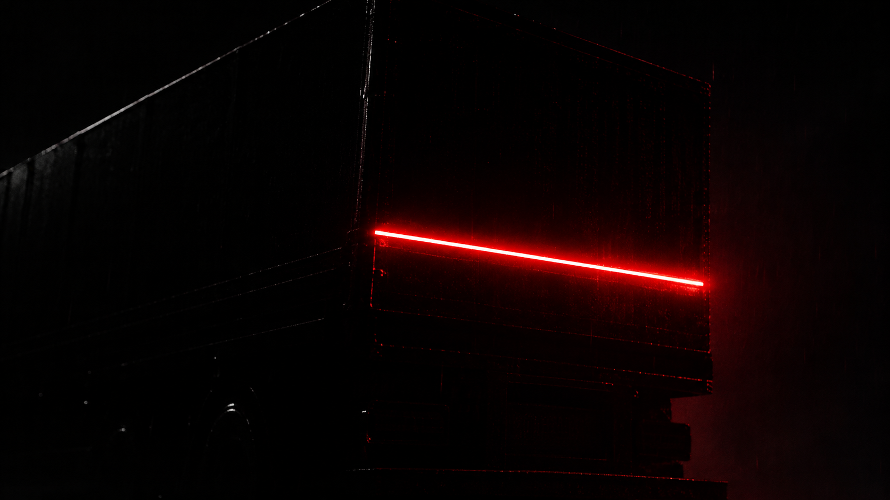

# Spot Vision

Site institucional da **Spot Vision**, startup que instala LEDs conectados a sensores em caminhões para sinalizar veículos nos pontos cegos.

> *Your security, our business*

## Sobre o produto (conforme descrito pela equipe)

- Um LED conectado a um sensor acende quando um veículo está no ponto cego (atrás, nas laterais e na frente).
- Quanto mais perto o veículo, mais forte o LED.
- Com o caminhão parado, um som alerta as pessoas ao redor de que ele está saindo.

> A demonstração interativa do site é **ilustrativa**. Não representa especificações técnicas reais (alcance, tempos, níveis de intensidade etc.).

## Tecnologias

HTML5, CSS3 e JavaScript puro, sem frameworks nem build. Basta abrir o `index.html` no navegador.

## Estrutura

```
spot-vision/
├── index.html
├── style.css
├── script.js
├── figura_1.png        # foto da seção "Sobre"
├── figura_2.png        # imagem alternativa (efeito hover)
└── vdo/
    └── main_video.mp4  # vídeo de fundo do hero
```

## Seções

1. **Hero:** vídeo de fundo, logo "Spot V·i·s·i·o·n" e slide dinâmico.
2. **Sobre:** texto e foto.
3. **Demonstração:** simulação do LED traseiro reagindo à distância e botão de alerta sonoro simulado.
4. **Serviços:** detecção, sinal visual e sinal sonoro, com foto.
5. **Isto é para mim?:** seção expansível (link na navbar) com os públicos do serviço.
6. **Contato.**

## Como personalizar

**Vídeo de fundo:** coloque o arquivo em `vdo/main_video.mp4`. Se ele não existir, o hero mostra um degradê cinza. O fim do vídeo se dissolve na cor da página por uma máscara CSS (`.hero-media` no `style.css`).

**Fotos:** os dois espaços de foto ficam nas seções Sobre e Serviços. Troque o conteúdo do `<figure class="photo">` por uma ``:

```html
<figure class="photo">
    
</figure>
```

**Slides do hero:** edite o array `slides` no `script.js`. Cada item tem `t` (título) e `p` (texto). Os slides, os pontos e a barra de progresso são gerados automaticamente.

**Públicos ("Isto é para mim?"):** edite os `<div class="aud">` dentro de `#para-quem` no `index.html`.

**Contato:** troque o placeholder da seção `#contato` pelo link do WhatsApp (`https://wa.me/55DDDNUMERO`) ou pelo e-mail.

## Design

| Variável | Valor | Uso |
|---|---|---|
| `--dark-gray` | `#0a0a0a` | fundo |
| `--little-dark-gray` | `#202020` | navbar, cards |
| `--white` | `#eee` | texto |
| `--gray` | `#a0a0a0` | texto secundário |
| `--red` | `#e10600` | detalhes que remetem ao LED |

- **Fontes:** Inter (textos) e Plus Jakarta Sans (títulos), via Google Fonts.
- **Estilo:** minimalista, preto, cinzas e branco, com vermelho apenas em detalhes.
- **Tema:** o site é fixo no modo escuro. As variáveis do modo claro ainda estão no CSS (`:root[data-theme="light"]`), mas o botão de alternância foi removido.
- **Responsivo:** abaixo de 920px a navbar vira menu hambúrguer.
- **Animações:** entrada suave da página, revelação ao rolar, slide automático e seção expansível. Respeita `prefers-reduced-motion`.

## Pendências antes de publicar

- [ ] Adicionar `vdo/main_video.mp4`.
- [ ] Adicionar as fotos reais nos dois espaços.
- [ ] Preencher o contato (WhatsApp / e-mail).
- [ ] Revisar os textos dos públicos em "Isto é para mim?", que são genéricos.
- [ ] Revisar o texto de Seguradoras: ele não afirma parceria, apenas interesse em segurança de caminhões.

## Navegadores

Testado apenas em desenvolvimento, sem bateria de testes. Usa recursos modernos (`color-mix`, `mask-image`, `svh`), então pede navegadores atuais.
